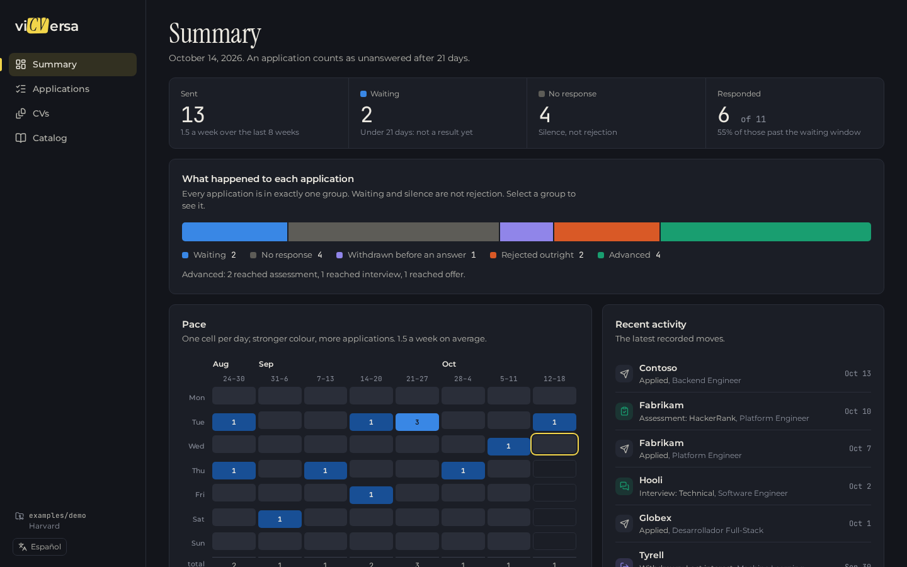
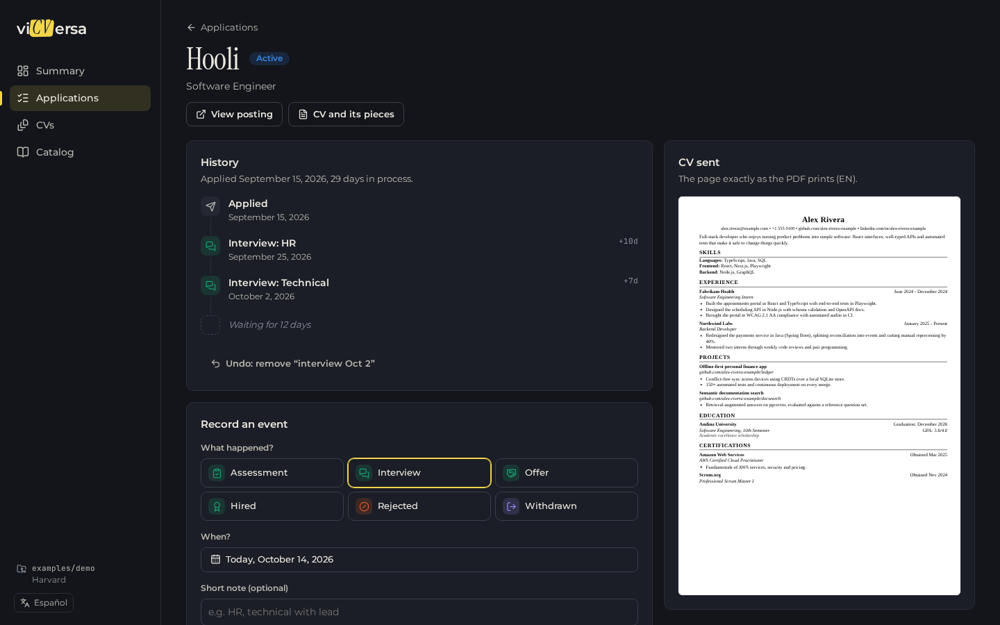
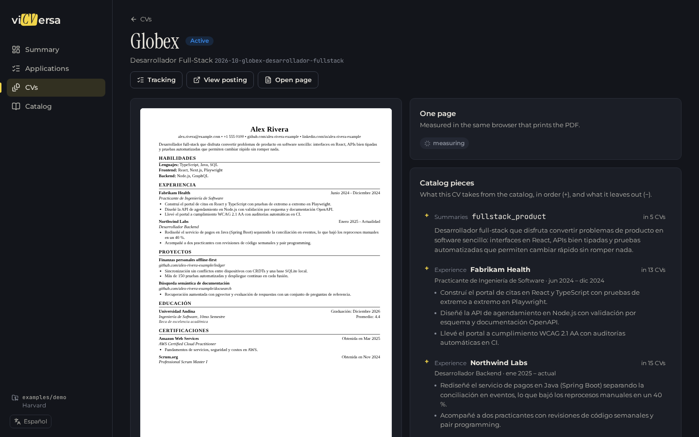

<p align="center">
  <picture>
    <source media="(prefers-color-scheme: dark)" srcset="docs/brand/wordmark-dark.png">
    
  </picture>
</p>

<p align="center"><strong>One catalog. Many one-page CVs. An honest tracker for where each one went.</strong></p>

https://github.com/user-attachments/assets/6825295b-b110-4aac-8c91-fe6210b560d6

Your career, under version control: everything you have done lives once, as
YAML, and every CV you send is a selection from it — rendered in Chromium and
guaranteed to fit on one page, or the build stops and tells you exactly what to
cut. Then a local panel shows what happened to each application, without
blurring waiting, silence and rejection into one "it didn't work".

## Quickstart

```bash
git clone https://github.com/RonyOz/vicversa && cd vicversa && pnpm install
pnpm ui                       # the panel on a fictional demo profile → http://localhost:4747
echo "VICVERSA_HOME=$HOME/my-cv" > .env && pnpm ui   # …then on your own data
```

Requires Node 24 and pnpm. Playwright's Chromium is installed with the
dependencies; nothing leaves your machine.

## How it works



```
catalog/*.yaml  ──┐                                     ┌──> one-page PDF
                  ├──> resolve ──> template ──> Chromium ┤
applications/*.yaml ┘                                     └──> measure: fits? what to cut?
```

- **Catalog** — summaries, experience, projects, certifications, education and
  skills, each piece with an id and text in every language you write in.
- **Application** — one file per CV: which summary, which bullets in which
  order, which skills. Selections are bullet ids; the item each bullet belongs
  to is derived.
- **Template** — how the page looks. vicversa measures what the template marks
  and prices every way out when a CV spills over:

  ```
  ✗ baseline-en

    Over by 16.0pt — about 1.2 body lines.

    Smallest single cut that fixes it: data_ml (summary, swap, no content lost, frees 27.0pt)

    Options, cheapest first:
        summary fullstack_product              13.5pt  swap, no content lost
        bullet ledger.sync                     13.5pt  1 line
      ✓ summary data_ml                        27.0pt  swap, no content lost
      ✓ bullet andina_ta.students              27.0pt  2 lines
  ```

  Heights are measured in the same browser that prints the PDF: character
  counts and font tables both lie about where a justified line breaks.

## The panel

| View | What it answers |
|---|---|
| **Summary** | How many sent, how many waiting, how many answered — with denominators. Pace as a daily calendar. |
| **Applications** | Every application on a shared timeline; tabs by state, search (`/`), stage and language filters, sorting — all in the URL. |
| **Application** | Its history, the event form (stage, a date picker that knows its past events, note suggestions), undo, and the exact CV page you sent. |
| **CVs** | Every CV as a real-page thumbnail with its one-page fit. Each shows its pieces as a diff: **+** taken from the catalog, **−** left out. |
| **Catalog** | Every piece with how many CVs use it — and which never made it into one. |

English and Spanish, dark and light. The only writes are recording and
undoing events; your YAML stays the source of truth.

<p>
  
  
</p>

## Your data lives outside the tool

```
my-cv/                    # usually a private git repository
  vicversa.yaml           # template: harvard
  catalog/*.yaml          # the single source of truth
  applications/*.yaml     # one file per CV; git history is the audit trail
  templates/<id>/         # optional: your own template
  out/                    # rendered PDFs
```

Point `VICVERSA_HOME` at it (a `.env` at the repo root works; it is ignored by
git). Without it, the fictional demo in `examples/demo/` is used — it is also
the fixture for every test.

## Templates

| Template | Look |
|---|---|
| `harvard` (default) | Harvard career-office classic: one column, Tinos (Times metrics), small-caps headings over a rule, US Letter |
| `classic-ats` | Plain one-column layout any applicant tracking system parses: Arimo (Arial metrics), standard headings, A4 |

Pick one in `vicversa.yaml`. **Your own template** is a folder
`templates/<id>/` in your data: a `theme.yaml` with every measurement in points
and a `template.tsx` that default-exports a `TemplateDefinition` from
`"vicversa/template"`. Copy `src/templates/harvard/` to start. The one rule:
mark what can be measured — `measure.content`, `measure.section(id)`,
`measure.item(id)`, `measure.bullet(id)` — and render `<SummaryProbes>`; that is
what gives your design the one-page guarantee. Fonts are vendored in
`assets/fonts/` (`scripts/fetch-fonts.ts`).

## For agents: MCP server

`pnpm mcp` serves the same operations to AI clients over stdio (`.mcp.json` and
`opencode.json` register it): `list_applications`, `get_application`,
`get_catalog`, `get_status`, `validate`, `render`, `track` and
`undo_last_event`, all returning typed data. Skills in `.claude/skills/` teach
an agent to tailor a CV from a job posting and to keep the tracker current.

## CLI

```bash
pnpm cv list                        # catalog counts and applications
pnpm cv render <application>        # one PDF into <data>/out/ (--force to write an overflowing one)
pnpm cv validate [application…]     # does every CV fit on one page?
pnpm cv status [application]        # pace, funnel, applications by state / one timeline
pnpm cv track <application> <stage> [--date YYYY-MM-DD] [--note TEXT]
pnpm test                           # unit and integration tests, on the demo
pnpm brand                          # regenerate README images from the demo
```

## Repository

| Path | What's in it |
|---|---|
| `src/ops.ts` | Every operation as data — shared by the CLI, the MCP server and the panel |
| `src/templates/` | The template contract (`kit.tsx`), registry and bundled templates |
| `src/render.ts`, `src/validate.ts` | Measure in Chromium; decide whether it fits and what to cut |
| `src/tracking*.ts` | Timelines, state, pace and the response funnel; edits that keep YAML byte for byte |
| `src/ui/` | The panel: JSON API and React app |
| `examples/demo/` | A fictional data folder: the demo and the test fixture |
| `ARCHITECTURE.md` | Design decisions and why |

## License

[MIT](LICENSE)
